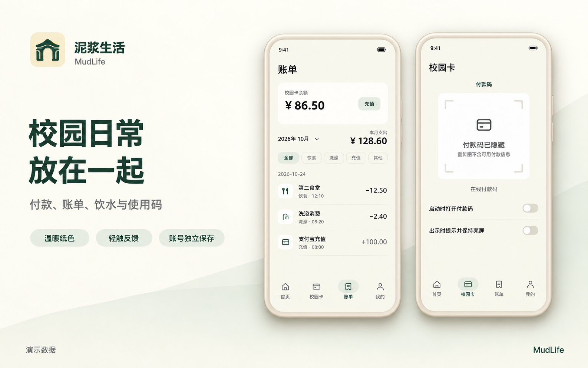
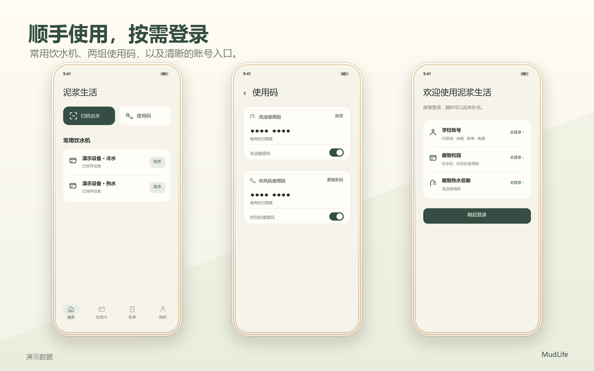
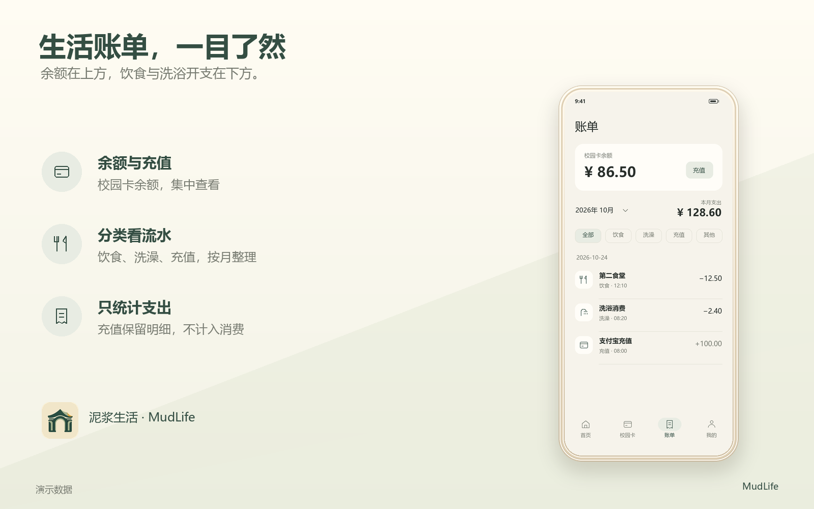

<p align="center">
  
</p>

<h1 align="center">江大生活 · Jiangda Life</h1>
<p align="center"><b>校园日常，放在一起。</b><br>江苏大学一卡通 · 本科教务课表 · 趣智校园 · 趣智后勤热水</p>
<p align="center">v1.5.1 &nbsp; · &nbsp; Android 8.0+ &nbsp; · &nbsp; Kotlin / Jetpack Compose</p>

<p align="center">
  <a href="https://gitee.com/cainite/MudLife/releases"><b>Gitee 国内下载</b></a> &emsp;
  <a href="https://github.com/Cainite07/MudLife/releases"><b>GitHub Releases</b></a> &emsp;
  <a href="CHANGELOG.md">更新记录</a> &emsp;
  <a href="https://github.com/Cainite07/MudLife/issues">问题反馈</a>
</p>



江大生活面向江苏大学学生，可以看课表、出示校园付款码、查生活账单和宿舍电费，也可以扫码出水、查看洗浴和吹风机使用码。

<p align="center"><a href="assets/promo/jiangda-life-social.png">下载完整宣传长图 · 分享给同学</a></p>

## 四个页面，各有安排

<table>
  <tr>
    <td width="50%" valign="top">
      <h3>首页 · 随手使用</h3>
      <p>点校园卡余额直接出示付款码。<br>下方可扫码出水、查宿舍电费、查看使用码。</p>
    </td>
    <td width="50%" valign="top">
      <h3>课表 · 查看本周</h3>
      <p>从本科教务导入课程，或自行添加、修改。<br>在手机桌面添加「今日课表」即可查看当天安排。</p>
    </td>
  </tr>
  <tr>
    <td width="50%" valign="top">
      <h3>账单 · 理清开销</h3>
      <p>月报展示每日支出与分类占比。<br>生活小记自动轮换，余额与充值集中在卡片面板。</p>
    </td>
    <td width="50%" valign="top">
      <h3>我的 · 管理服务</h3>
      <p>账号管理、电子学生卡、本部宿舍电费。<br>外观、触感与应用更新。</p>
    </td>
  </tr>
</table>



## 三个账号，按需登录

- **学校账号** — 校园卡付款码、余额、账单、充值、电费、电子学生卡与本科教务课表。教务系统可能要求再次认证。
- **趣智校园** — 饮水机与吹风机使用码。
- **趣智后勤热水** — 洗浴使用码。

首次安装有可跳过的引导，也可以在“我的 → 账号管理”随时补充。三个账号独立保存，未登录的服务提供对应入口。“我的 → 外观”可选跟随系统、浅色或深色。

学校服务依赖校方系统与网络；需要微信的支付流程会进入相应环境，返回后核对原订单结果。在线付款码不替代 NFC 校园卡。

## 导入与编辑课表

打开底栏「课表」，点右上角「更多功能 → 教务同步」，进入学校本科教务。应用读取个人课表后会列出待导入课程，核对学期和课程再点「确认导入」。也可以新建空白学期，从头添加课程。导入后的课程可以在本机修改。

## 生活账单，一目了然



账单以**学校校园卡流水为基础，补充饮水、吹风机与洗浴的独立设备消费**。设备记录按所选月份查询，排除钱包充值与退款，同订单优先采用学校流水；洗浴记录扣款来源不明或校园卡扣款尚未匹配时标为“待核实”，暂不计入支出。学校账单沿用本机缓存，设备记录按账号加密保存；退出或换号清理内存，下次登录同一账号可恢复。

月报直接展示每日支出柱状图、日历及分类占比；生活小记在本机按规则生成，每 10 秒切换，不调用 AI 服务。流水不完整或金额未知时不显示误导性汇总。顶部「校园卡」打开余额、选卡与充值面板，下方按日期分组，提供全部、饮食、洗澡、吹风、饮水、充值、其他筛选。当天饮水合并为最后一行“饮水 · N笔”，点击展开明细。设备历史在使用账单时静默分批补齐，每完成一个月即加密保存，中断后自动续传；已知更早记录会扩展同步范围。全部月份显示当前记录的支出合计，金额缺失时保留未知状态。

> 宣传图为演示界面，数据全部虚构；付款码与使用码均已隐藏。图片不含真实姓名、手机号、学号、宿舍、设备标识或账号会话。

## 下载与覆盖升级

国内网络优先使用 [Gitee 发行版](https://gitee.com/cainite/MudLife/releases)，也可从 [GitHub Releases](https://github.com/Cainite07/MudLife/releases) 下载。两端提供相同 APK 与 SHA-256 校验文件；应用内更新并行连接 Gitee 与 GitHub，使用先收到有效数据的源，并保留备用源。

正式版包名为 `cn.mudlife.app`，沿用固定签名，正常覆盖升级保留本机登录和保存的数据。**1.3.18 之前的旧签名版本不能直接覆盖升级**；切换前请保存所需信息，卸载旧包会清除其数据。

## 开发与反馈

Kotlin 2.0.21 · Compose / Material 3 · Retrofit / OkHttp · MQTT · CameraX / ML Kit。构建和运行课表测试使用 Android SDK 36、JDK 21。

```bash
./gradlew testDebugUnitTest assembleDebug
./gradlew assembleRelease
```

正式版仅打包 **ARM64（arm64-v8a）**，文件名为 `MudLife-1.5.1.apk`，内置离线扫码模型。

正式构建需要维护者已有的固定签名，私钥与凭据不在仓库中。详见 [签名说明](signing/README.md) · [双平台发布](docs/RELEASING.md) · [宣传图制作](assets/promo/prompts.md)。

发行构建检查固定证书身份，配置缺失时停止，不会创建替代密钥。GitHub 自动检查运行单元测试；正式发行由维护者同步上传两端。宣传图采用统一尺寸模板，可通过项目脚本重复导出。

反馈请附版本、系统、操作步骤和错误提示，截图中遮盖个人信息与使用码。本项目采用 [MIT License](LICENSE)。
