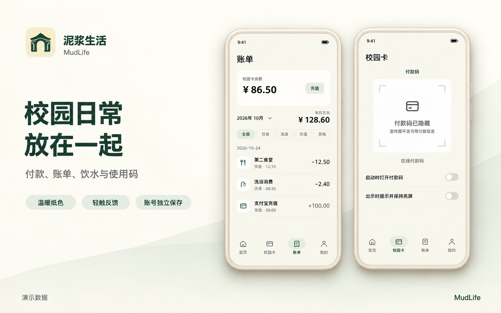
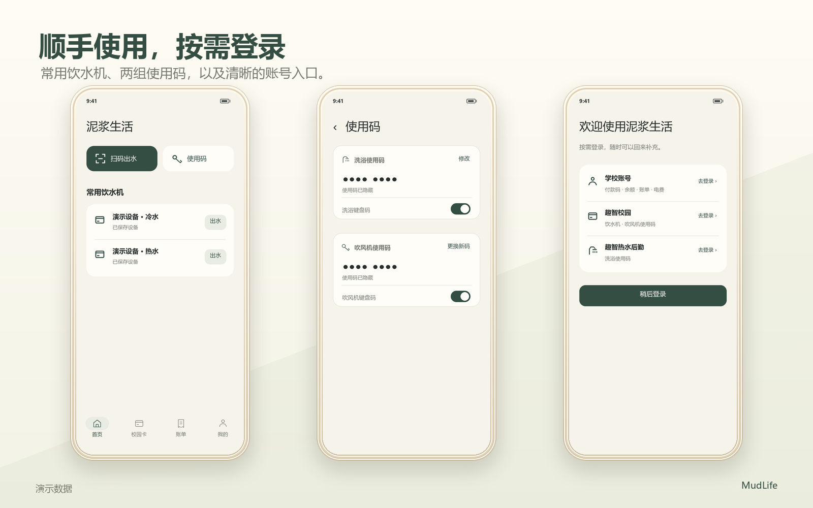
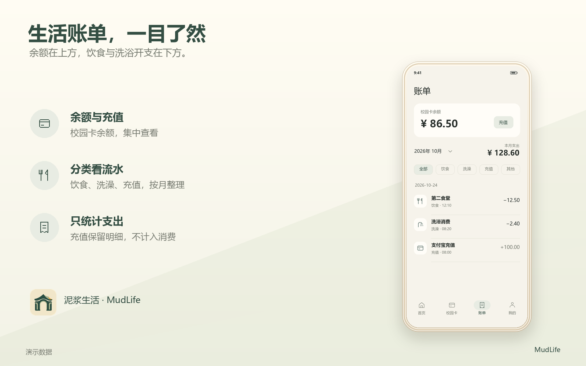

<p align="center">
  
</p>

<h1 align="center">泥浆生活 · MudLife</h1>
<p align="center"><b>校园日常，放在一起。</b><br>江苏大学一卡通 · 趣智校园 · 趣智热水后勤</p>
<p align="center">v1.4.6 &nbsp; · &nbsp; Android 8.0+ &nbsp; · &nbsp; Kotlin / Jetpack Compose</p>

<p align="center">
  <a href="https://gitee.com/cainite/MudLife/releases"><b>Gitee 国内下载</b></a> &emsp;
  <a href="https://github.com/Cainite07/MudLife/releases"><b>GitHub Releases</b></a> &emsp;
  <a href="CHANGELOG.md">更新记录</a> &emsp;
  <a href="https://github.com/Cainite07/MudLife/issues">问题反馈</a>
</p>



MudLife 面向江苏大学的校园日常，把校园卡付款、生活账单、饮水机和两组使用码放进同一个应用。温暖纸黄与墨绿配色，搭配轻触反馈，让常用操作更顺手。

<p align="center"><a href="assets/promo/mudlife-social.png">下载完整宣传长图 · 分享给同学</a></p>

## 四个页面，各有安排

<table>
  <tr>
    <td width="50%" valign="top">
      <h3>首页 · 随手使用</h3>
      <p>扫码出水，保存常用饮水机。<br>洗浴与吹风机使用码，一起查看。</p>
    </td>
    <td width="50%" valign="top">
      <h3>校园卡 · 出示付款</h3>
      <p>在线付款码，切换校园卡与付款方式。<br>按需提亮、保持亮屏。</p>
    </td>
  </tr>
  <tr>
    <td width="50%" valign="top">
      <h3>账单 · 理清开销</h3>
      <p>余额与充值入口集中展示。<br>按月份和分类查看校园卡流水。</p>
    </td>
    <td width="50%" valign="top">
      <h3>我的 · 管理服务</h3>
      <p>账号管理、电子学生卡、本部宿舍电费。<br>外观、触感与应用更新。</p>
    </td>
  </tr>
</table>



## 三个账号，按需登录

- **学校账号** — 校园卡付款码、余额、账单、充值、电费与电子学生卡。
- **趣智校园** — 饮水机与吹风机使用码。
- **趣智热水后勤** — 洗浴使用码。

首次安装有可跳过的引导，也可以在“我的 → 账号管理”随时补充。三个账号独立保存，未登录的服务提供对应入口。“我的 → 外观”可选跟随系统、浅色或深色。

学校服务依赖校方系统与网络；需要微信的支付流程会进入相应环境，返回后核对原订单结果。在线付款码不替代 NFC 校园卡。

## 生活账单，一目了然



账单统一采用**学校校园卡流水，只统计支出**。充值保留明细，退款、补助不计入消费，趣智独立钱包记录不混入。已同步账单保留本机缓存，月份选择按账号保存。

顶部可选卡、查看余额与充值，下方按日期分组，提供全部、饮食、洗澡、充值、其他筛选。同步未完成或金额缺失时，不显示不完整的消费总额。

> 宣传图为演示界面，数据全部虚构；付款码与使用码均已隐藏。图片不含真实姓名、手机号、学号、宿舍、设备标识或账号会话。

## 下载与覆盖升级

国内网络优先使用 [Gitee 发行版](https://gitee.com/cainite/MudLife/releases)，也可从 [GitHub Releases](https://github.com/Cainite07/MudLife/releases) 下载。两端提供相同 APK 与 SHA-256 校验文件；应用内更新并行连接 Gitee 与 GitHub，使用先收到有效数据的源，并保留备用源。

正式版包名为 `cn.mudlife.app`，沿用固定签名，正常覆盖升级保留本机登录和保存的数据。**1.3.18 之前的旧签名版本不能直接覆盖升级**；切换前请保存所需信息，卸载旧包会清除其数据。

## 开发与反馈

Kotlin 2.0.21 · Compose / Material 3 · Retrofit / OkHttp · MQTT · CameraX / ML Kit。构建需要 Android SDK 36、JDK 17 及以上。

```bash
./gradlew testDebugUnitTest assembleDebug
./gradlew assembleRelease
```

正式构建需要维护者已有的固定签名，私钥与凭据不在仓库中。详见 [签名说明](signing/README.md) · [双平台发布](docs/RELEASING.md) · [宣传图制作](assets/promo/prompts.md)。

发行构建检查固定证书身份，配置缺失时停止，不会创建替代密钥。GitHub 自动检查运行单元测试；正式发行由维护者同步上传两端。宣传图采用统一尺寸模板，可通过项目脚本重复导出。

反馈请附版本、系统、操作步骤和错误提示，截图中遮盖个人信息与使用码。本项目采用 [MIT License](LICENSE)。
